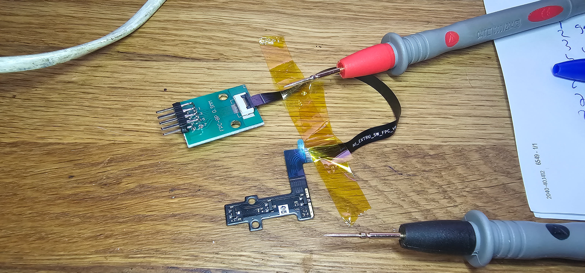
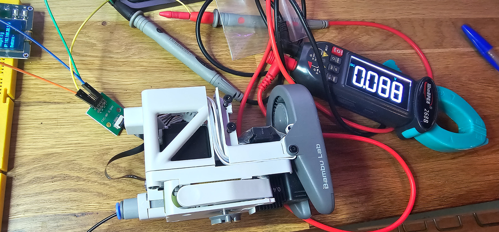

# A1 Hotend Sensor Board: Reverse Engineering

*Bambu Lab A1 hotend · decoding an 8-pin flat cable, three Hall-effect sensors and a multimeter into a working map of filament presence, cutter position and filament tangling.*

**Contents:** [Story](#the-story) · [Photos](#bench-photos) · [Schematic](#schematic) · [Pinout](#pinout) · [Measurements](#measured-output-voltages) · [Sensor datasheet](#sensor-datasheet-mt910x-rev-21) · [Open points](#open-points)

---

## The story

The A1 hotend assembly carries a small sensor board on a flat cable. Three magnetic sensors sit on it, and each one reads a magnet attached to a moving part of the filament path. The goal was to understand what the printer sees, so the sensors could be read directly, outside the printer's firmware.

1. **Identify the connector.** The board's 8-pin, 0.5 mm pitch flat cable was connected to a home-made FPC-8P 0.5 mm breakout board with 2.54 mm header pins, so the signals could be probed with ordinary test leads.
2. **Identify the chips.** The chip markings were read with a magnifier glass. The marking reads `9105`, which identifies the Hall sensors as Magntek `MT9105` (MT910X family, ratiometric linear, analog output). The datasheet pin configuration then mapped the pins to their functions.
3. **Confirm the supply.** Pins 7 and 8 were confirmed as VCC.
4. **Mount and measure.** The sensor board was refitted into the hotend assembly, so the magnets sit in their real positions. The supply was 3.3 V. Output voltages were logged for each state: no filament, filament inserted, cutter at rest and cutter pressed, and tangle released and compressed.
5. **Interpret.** The presence and cutter outputs behave as switches: they flip hard at a defined position. The tangle output varies linearly with the rate of compression of the buffer, so it can be read as an analog signal.

> The flat cable is printed `N1_EXTRU_SW_FPC_V8`, consistent with an extruder switch assembly.

---

## Bench photos

| | |
|---|---|
|  |  |
| Breakout board (FPC-8P 0.5 mm) on the sensor flat cable, multimeter probes on the cable. | Sensor board fitted in the hotend assembly. Clamp meter shows 0.088 V DC on one output. |

---

## Schematic

Signal map as measured. This shows the mapping, not a traced netlist.

```
          Sensor flat cable (8-pin, 0.5 mm)                 Sensor (MT9105 Hall IC)
          ┌─────────────────────────┐
   GND ───┤ 1  GND                  │
   GND ───┤ 2  GND                  ├── GND bus ──────────── all three sensors
          │                         │
   OUT ───┤ 3  Filament presence    ├───────────────────────► Filament presence   → measure
   OUT ───┤ 4  Cutter position      ├───────────────────────► Filament cutter lever → measure
          │ 5  NC / unknown         │   (not connected)
   OUT ───┤ 6  Tangle sense         ├───────────────────────► Filament tangle      → measure
   VCC ───┤ 7  VCC (3.3 V)  ────────┤─── supply to all sensors
   VCC ───┤ 8  VCC (3.3 V)  ────────┤─── supply to all sensors
          └─────────────────────────┘
```

### Sensor internal function (MT910X datasheet, Fig. 5)

```
  VCC ──┬── Power clamp ── Regulator ── Bandgap / VREF ── OSC (chopper 780 kHz)
        │                     │
        │                TC-R spinning current ── Hall plates ── AMP ── Sample & hold ── Drv ──┬── OUT
  GND ──┴────────────────────────────────────────────────────────────────────────────────────┘
```

---

## Pinout

| Pin | Function | Type | Notes |
|:---:|---|:---:|---|
| 1 | GND | GND | Ground, shared with pin 2 |
| 2 | GND | GND | Ground, shared with pin 1 |
| 3 | Filament presence sense | OUT | Analog Hall output |
| 4 | Filament cutter position | OUT | Analog Hall output |
| 5 | Not connected / unknown | ? | No function identified yet |
| 6 | Filament tangle sense | OUT | Analog Hall output |
| 7 | Supply (VCC) | VCC | Confirmed, 3.3 V |
| 8 | Supply (VCC) | VCC | Confirmed, 3.3 V |

---

## Measured output voltages

Measured at each output with the sensor installed in the hotend assembly, supply **VCC = 3.3 V**.

### Filament presence (pin 3)

| State | Voltage | Field (calculated) |
|---|---:|---:|
| No filament | 1.10 V | ≈ −175 G |
| Filament inserted | 0.03 V | ≈ −514 G (outside linear range) |

```
0 V ◄────────────────────────────────────────────────► 1.1 V
    filament inserted (0.03 V)               no filament (1.1 V)
```

### Filament cutter (pin 4)

| State | Voltage | Field (calculated) |
|---|---:|---:|
| Cutter at rest | 1.70 V | ≈ +16 G |
| Cutter lever fully depressed | 0.30 V | ≈ −429 G (edge of linear range) |

```
0.3 V ◄──────────────────────────────────────────────────► 1.7 V
      lever depressed                          at rest
```

### Filament tangle (pin 6)

| State | Voltage | Field (calculated) |
|---|---:|---:|
| No tangle | 0.10 V | ≈ −492 G (outside linear range) |
| Fully compressed (tangle) | 2.20 V | ≈ +175 G |

```
0.1 V ◄────────────────────────────────────────────────► 2.2 V
      no tangle                    fully compressed
```

> **Direction summary.** Presence output falls when filament is inserted. Cutter output falls when the lever is pressed. Tangle output rises when the spring is compressed. The three signals have opposite polarity, which matters when reading them in code.

---

## Observed behaviour

| Sensor | Observed behaviour | Practical reading |
|---|---|---|
| Filament presence (pin 3) | Hard flip at a defined position | Digital-like: inserted / not inserted |
| Filament cutter (pin 4) | Hard flip at a defined position | Digital-like: lever pressed / at rest |
| Filament tangle (pin 6) | Varies linearly with the rate of compression of the buffer | Analog: usable as a compression signal |

- **The hard flips are mechanical.** When filament is inserted, it pushes a lever that moves a small magnet. The magnet is either over the Hall sensor or not, so filament presence has only two real states. The cutter has a large movement path, but only the last part of that path moves the magnet over the sensor, so the cutter output changes only over that short end stretch.
- **The tangle output is linear across most of its travel.** Its 0.10 V no-tangle endpoint lies below the 0.3 V linear limit at 3.3 V, so the calculated field is only valid between 0.3 V and 3.0 V.

---

## Sensor datasheet (MT910X, Rev 2.1)

The MT9105 is a ratiometric, linear Hall-effect IC with analog output, in SOT-23 (thin outline) or Flat TO-92. Its output is centred at half the supply voltage when there is no field and moves linearly with the flux density perpendicular to the top of the package.

| Parameter | Value | Condition |
|---|---|---|
| Supply voltage | 3.0 – 5.5 V | Operating range |
| Quiescent output (VOQ) | 2.50 V @ 5 V · 1.65 V @ 3.3 V | B = 0, TA = 25 °C |
| Sensitivity, MT9105 | 5.00 mV/G @ 5 V · 3.15 mV/G @ 3.3 V | Typical, TA = 25 °C |
| Linear field range, MT9105 | ±440 G @ 5 V · ±430 G @ 3.3 V | Typical |
| Output swing | 0.3 – 4.7 V @ 5 V · 0.3 – 3.0 V @ 3.3 V | Linear region, per Fig. 2 and 3 |
| Output load | Rout 2 Ω typ. · RL ≥ 4.7 kΩ · CL ≤ 10 nF | IOUT ≤ ±1.5 mA |
| Response time | 15 µs typ. | TA = 25 °C |
| Bandwidth | 30 kHz typ. | |
| Noise, MT9105 | 4.88 mVRMS | TA = 25 °C |
| Operating temperature | −40 °C to 150 °C | |

### Converting a reading to field strength

Because the output is ratiometric, the zero-field level depends on VCC. For a reading `Vout` at supply `VCC`, the flux density is:

```
B [G] = (Vout − VCC/2) / S

At VCC = 3.3 V:  VCC/2 = 1.65 V,  S = 3.15 mV/G
```

*Example:* at 3.3 V, a reading of 0.30 V gives (0.30 − 1.65) / 0.00315 ≈ −429 G, the edge of the linear range. The cutter depressed reading sits there.

> **Readings outside the linear range.** The datasheet's linear output at 3.3 V runs from 0.3 V to 3.0 V. The presence reading of 0.03 V and the tangle reading of 0.10 V both fall below 0.3 V, so those sensors are saturated in those positions. They remain reliable as binary states (magnet present or absent, tangle or no tangle), but the calculated field values for those states are not a measure of distance.

---

## Open points

- [ ] Identify pin 5. It may be unused, or it may be a test or shield connection.
- [ ] Repeat the readings at 5 V and compare with the 3.3 V set, to confirm the ratiometric behaviour.
- [ ] Find the exact position where the presence and cutter outputs flip, and whether they show hysteresis (different thresholds going in and out).
- [ ] Measure the cutter's full travel and the length of the final stretch that moves the magnet over the sensor.
- [ ] Record the tangle output against a known compression to get its voltage-to-compression curve over its linear span.

---

*Generated from bench measurements (3.3 V supply, chip marking read with a magnifier) and the MT910X datasheet (Magntek, Rev 2.1). The schematic shows the measured signal mapping and is not a traced netlist. Field values are calculated from the datasheet sensitivity and VCC/2 zero point.*
