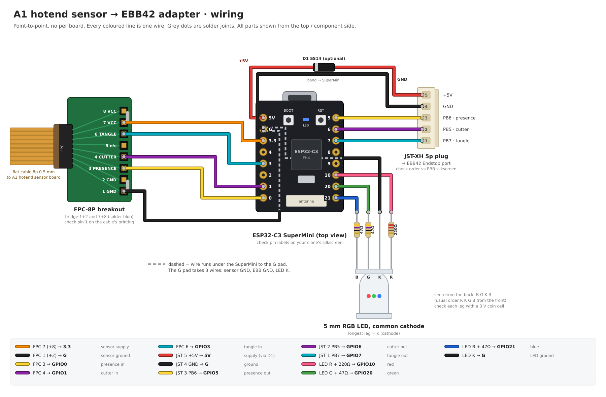

# A1 hotend sensor → EBB42 adapter

An ESP32-C3 SuperMini reads the three analog Hall outputs of the A1 hotend
sensor board. It turns each one into a digital line for the BIGTREETECH EBB42
(v1.2) **Endstop** connector. You set the thresholds, hysteresis, debounce and
output polarity over USB, and they are stored in flash.

```
 A1 sensor board                 adapter (ESP32-C3 SuperMini)                 EBB42 Endstop (P10)
 FPC 8p 0.5 mm                                                                JST-XH 5p
 ┌──────────────┐   3V3   ┌─────────────────────────────────────────┐  5V   ┌────────────────┐
 │ 7,8 VCC      │◄────────┤ 3V3 (onboard LDO)          5V ◄──(D1)───┼───────┤ 5  +5V         │
 │ 1,2 GND      ├─────────┤ GND                        GND ─────────┼───────┤ 4  GND         │
 │ 3 presence   ├────────►│ GPIO0 (ADC)          GPIO5 (OD) ────────┼──────►│ 3  Stop1 → PB6 │
 │ 4 cutter     ├────────►│ GPIO1 (ADC)          GPIO6 (OD) ────────┼──────►│ 2  Stop2 → PB5 │
 │ 6 tangle     ├────────►│ GPIO3 (ADC)          GPIO7 (OD) ────────┼──────►│ 1  Stop3 → PB7 │
 │ 5 NC         │         │ GPIO10/20/21 ── RGB LED (status)        │       └────────────────┘
 └──────────────┘         └─────────────────────────────────────────┘        each input on the EBB:
                                                                             10k pull-up to 3.3 V,
                                                                             1k series to MCU
```

Wiring diagram for building it point to point: [`docs/wiring.png`](docs/wiring.png)
(source: `docs/make_wiring.py`, then `rsvg-convert -b white docs/wiring.svg -o docs/wiring.png`).



## Why the EBB42 Endstop connector

From the EBB42 v1.2 schematic, connector P10 carries **+5V, GND and three
inputs**. Each input has a **10 kΩ pull-up to the EBB's 3.3 V** (R35–R37) and a
1 kΩ series resistor to the MCU (R40–R42). That gives one 5-wire cable that
powers the adapter and carries all three signals, with no level shifting. The
ESP drives the lines **open-drain**: it only pulls them low, and the EBB's
pull-up sets the high level.

| P10 pin | EBB net | MCU pin | Adapter GPIO | Signal |
|:---:|---|:---:|:---:|---|
| 1 | Stop3 / Endstop3 | **PB7** | GPIO7 | tangle |
| 2 | Stop2 / Endstop2 | **PB5** | GPIO6 | cutter |
| 3 | Stop1 / Endstop1 | **PB6** | GPIO5 | filament presence |
| 4 | GND | | GND | |
| 5 | +5V (DC-DC, 1.5 A max) | | 5V (via D1 if fitted) | adapter supply |

> Check the pin numbering against the silkscreen of your EBB before you crimp.
> The BTT pinout image lists the pins top to bottom as PB7, PB5, PB6, GND, +5V.

## Fail-safe behaviour

A released (high) line is what the EBB sees when the adapter is unpowered,
rebooting, crashed or unplugged. So the defaults make **HIGH the state that
stops a print**:

| Signal | Line LOW | Line HIGH |
|---|---|---|
| presence | filament loaded | **no filament** → runout pause |
| tangle | OK | **tangle** → pause |
| cutter | lever at rest | lever pressed |

**Missing-sensor detection, with no extra parts.** About every 200 ms per
channel, the firmware switches on the ESP's internal pull-up (about 45 k) for
about 30 µs and takes one reading:

- **Sensor connected:** the MT9105 drives the pin through the board's series R,
  so the reading barely moves. Even with a large board resistor (100 k), it
  stays below 2.3 V.
- **Input open** (FPC unplugged or a broken trace): the pin rises to about 3.3 V.

If two probes in a row read above `fault_mv` (2700 mV by default), that line is
released and the LED blinks magenta. `status` shows the probe reading per
channel. The pull-up is on too briefly to disturb the board's filter capacitor.

## Adapter circuit

### Sensor side: direct wires

FPC pins 3, 4 and 6 connect straight to GPIO0, GPIO1 and GPIO3. No parts are
needed:

- **Filtering:** the A1 sensor board already has an R + C low-pass on each
  MT9105 output, and that C also feeds the ADC's sample capacitor.
- **Fault detection:** the firmware uses the internal pull-up (see
  [Fail-safe behaviour](#fail-safe-behaviour)). An external pull-up would form a
  divider with the board's series R and shift every reading.
- The sensor board is powered from the SuperMini's **3V3** pin, at the same
  3.3 V as the bench measurements. The MT9105 is ratiometric and the ESP's ADC
  is not, so a stable 3V3 matters. The onboard LDO is fine for this.
- ADC pins are GPIO0, GPIO1 and GPIO3, all on **ADC1**. GPIO2 is a strapping pin,
  and ADC2 (GPIO5) is unreliable on the C3. GPIO4 is a spare ADC input.
- At 11/12 dB attenuation the C3 ADC is linear up to about 2.5 V. All measured
  sensor levels (0.03–2.2 V) fall within that range.

### EBB side

- GPIO5, GPIO6 and GPIO7 connect directly to P10 pins 3, 2 and 1. No resistors
  are needed: the EBB already has the 10 k pull-up and the 1 k series resistor.
- **D1 (optional) is a Schottky diode** (SS14, B5819W or similar) from EBB +5V
  to the SuperMini 5V pin. On many SuperMini clones the 5V pin is wired straight
  to USB VBUS, so with USB plugged in and the EBB powered, the PC's 5 V and the
  EBB's 5 V rail would be tied together. The diode prevents that and drops about
  0.3 V, which the LDO handles easily.

  **Without D1**, wire 5V straight through and follow one rule: unplug the EBB
  cable before you plug in USB. USB then powers the adapter and the sensor
  board, so calibration still works.

### Status LED (5 mm RGB, common cathode)

| GPIO | Colour | Series R |
|:---:|---|:---:|
| 10 | red | 220 Ω |
| 20 | green | 47 Ω |
| 21 | blue | 47 Ω |

The common cathode goes to GND. GPIO20 and GPIO21 are the UART0 pins, but they
are free because the SuperMini logs over native USB. The firmware dims the LED
with PWM (`bright`). Adjust the resistors if one colour dominates.

Highest priority first:

| LED | Meaning |
|---|---|
| magenta blinking (4 Hz) | sensor fault (an input reads above `fault_mv`) |
| blue | cutter triggered |
| red | no filament |
| yellow, solid | tangle triggered (PB7 line active) |
| yellow, flashing | tension building. Starts at `flash_mv` (default 400 mV) at 1 Hz and speeds up linearly to 10 Hz as the reading approaches the tangle `on` threshold |
| green | all good: filament present, no tension, cutter at rest |

Yellow is red plus green (green PWM share `YELLOW_G` = 180/255 in `main.cpp`).
If it looks orange or lime, adjust that value or the resistors. The onboard
blue LED (GPIO8) blinks once per second as a heartbeat.

### BOM

| Qty | Part |
|:---:|---|
| 1 | ESP32-C3 SuperMini |
| 1 | FPC connector, 8 pin, 0.5 mm pitch (match the cable's contact side) |
| 1 | JST-XH 2.54 mm 5-pin header + cable to EBB42 Endstop |
| 1 | 5 mm RGB LED, common cathode |
| 1 | 220 Ω, 2 × 47 Ω (LED) |
| (1) | Schottky diode SS14 / B5819W (optional, see D1) |

That's the whole board: the SuperMini, two connectors and an LED with three
resistors, plus D1 if you want it.

Power budget: the ESP32-C3 at 80 MHz with no radio draws about 20 mA, and the
LED draws up to about 30 mA. The EBB's 5 V rail is rated for 1.5 A.

## Firmware

PlatformIO project in `firmware/` (Arduino framework, ESP32-C3).

```
cd firmware
pio run -t upload
pio device monitor        # 115200, any terminal works
```

After an upload over the C3's native USB, the chip can stay in download mode
(the log shows `boot:0x7 DOWNLOAD ... waiting for download`). Press RST, replug
USB, or run `esptool --chip esp32c3 -p <port> --after watchdog-reset read-mac`.
The watchdog reset re-enumerates USB, so `/dev/ttyACM0` can come back as
`ttyACM1`; the `/dev/serial/by-id/usb-Espressif_*` path stays stable.

The firmware samples each channel every 2 ms (averaging 4 ADC reads each time).
It runs a window comparator with hysteresis, then a per-channel debounce, and
then drives the output. On boot the lines stay released until the first
reading, so the EBB never sees a false "filament loaded".

### Threshold logic

Each channel has `on` and `off` thresholds in mV, and their order sets the
direction:

- `on < off`: the signal **falls** into the active state. It goes active at or
  below `on` and back to idle at or above `off`. Presence and cutter work this
  way.
- `on > off`: the signal **rises** into the active state. Tangle works this way.

The gap between the two thresholds is the hysteresis. A new state must hold for
`debounce` ms before it reaches the line.

Defaults (from the 3.3 V bench measurements in `../readme.md`):

| Channel | Idle | Active | on | off | debounce | Line when active |
|---|---:|---:|---:|---:|---:|:---:|
| presence | 1.10 V | 0.03 V | 450 | 650 | 20 ms | LOW |
| cutter | 1.70 V | 0.30 V | 850 | 1150 | 10 ms | HIGH |
| tangle | 0.10 V | 2.20 V | 1500 | 1100 | 50 ms | HIGH |

The tangle trip point is a guess, because the signal is proportional. Tune it on
the machine.

### Serial commands

```
status                     config, live readings, line levels
stream <ms>                print readings every <ms> (0 = stop)
peak                       min/max mV since last `peak`, then reset
set <ch> on <mV>           threshold that enters the active state
set <ch> off <mV>          threshold that returns to idle
set <ch> debounce <ms>
set <ch> level high|low    line level while active
learn <ch> idle|active     capture the current reading (~0.5 s average)
learn <ch> apply           set thresholds at 65 % / 35 % between the two points
fault <mV>
bright <0-255>
flash <mV> [min_hz max_hz] tangle level where yellow flashing starts, and its rate range
save | load | defaults
```

`<ch>` is `presence|cutter|tangle`, `0|1|2`, or a prefix (`p`, `c`, `t`).
Changes take effect immediately but are lost on reboot until you run `save`.

### Calibration on the machine

These steps also answer the open points about flip positions and hysteresis.

1. `stream 100` and move each mechanism slowly. Watch where the reading flips.
2. Per channel: hold the idle state and run `learn p idle`. Hold the active state
   and run `learn p active`. Then run `learn p apply`.
3. For tangle, push the buffer to the compression you want to trip at, read the
   mV value, and set `set t on <mV>` and `set t off <mV − 300>`. Then set
   `flash <mV>` just above the relaxed reading, so the LED starts warning when
   tension begins to build.
4. `save`.

## Klipper

Replace `EBBCan` with your EBB's MCU name. The EBB has hardware pull-ups, so no
`^` is needed.

```ini
[filament_switch_sensor filament]
# LOW = filament present -> invert so "triggered" means filament
switch_pin: !EBBCan:PB6
pause_on_runout: True

[filament_switch_sensor tangle]
# LOW = no tangle. Inverted, it behaves like a runout sensor that "runs out" on tangle.
switch_pin: !EBBCan:PB7
pause_on_runout: True
runout_gcode:
    M118 Filament tangle detected

[gcode_button cutter]
# HIGH = lever pressed
pin: EBBCan:PB5
press_gcode:
    M118 Cutter pressed
release_gcode:
```

Use `QUERY_FILAMENT_SENSOR SENSOR=filament` and `QUERY_BUTTON BUTTON=cutter` to
check the wiring.

## Open items

- [ ] Confirm that the SuperMini clone in hand has GPIO8 = LED and GPIO9 = BOOT
      (pinouts vary between makers).
- [ ] Confirm the EBB Endstop pin order on the physical board.
- [ ] Tune the tangle threshold on the machine.
- [ ] Board layout (perfboard first, PCB later).
